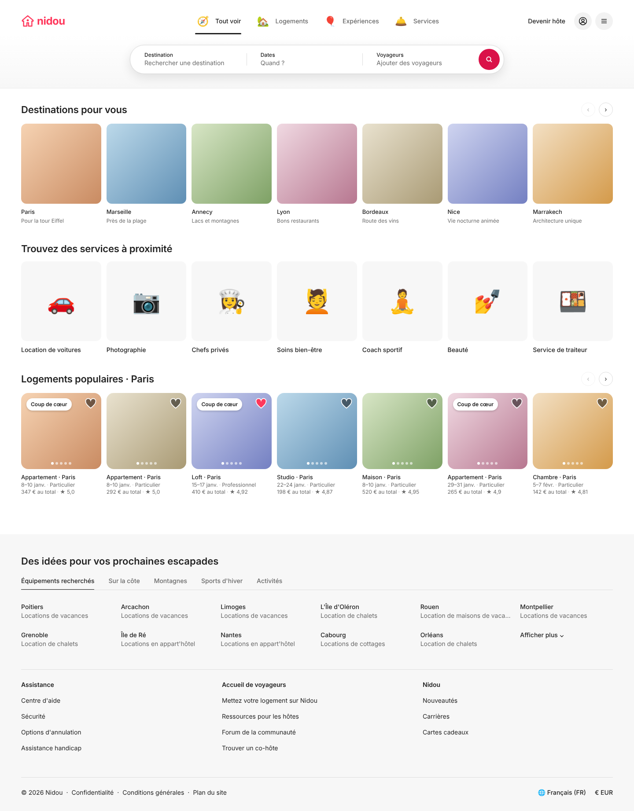
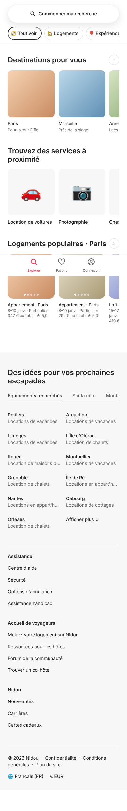

# Design system: Nidou

Visual spec for the airbnb.fr replica. Values come from [`recon/design-tokens.json`](./recon/design-tokens.json); structure follows [`architecture.md`](./architecture.md).
Reference mockup: [`design/mockups/home.html`](../design/mockups/home.html) (open in a browser), renders in [`design/mockups/renders/`](../design/mockups/renders).

| Desktop 1440 | Mobile 390 |
|---|---|
|  |  |

---

## 1. Brand

- **Name / wordmark:** `nidou`, lowercase, Inter 700, 24px, letter-spacing −0.5px, colour `brand`.
- **Mark:** outlined house with a dot (2.6px stroke, rounded joins), 30px in the header and 32px as the favicon. Replace it with a final logo later; keep the 30px slot.
- **Voice:** French first, tutoiement avoided (use *vous*), short labels ("Quand ?", "Ajouter des voyageurs").
- **Imagery:** real photos (Unsplash) at radius 12–16px; no 3D illustrations (Airbnb IP). Category icons: emoji in the mockup, **Lucide** icons (or our own illustrations) in production.

## 2. Foundations

### Colour
| Token | Hex | Use |
|---|---|---|
| `brand` | `#FF385C` | logo, active mobile nav, saved heart, focus accents |
| `brand-strong` | `#DA1249` | search button |
| `brand-gradient` | `#E61E4D → #E31C5F → #D70466` | primary CTA (Réserver), search button hover |
| `ink` | `#222222` | text, dark buttons, active tab underline |
| `ink-muted` | `#6A6A6A` | secondary text, inactive tabs, placeholders |
| `ink-faint` | `#B0B0B0` | disabled text |
| `line` | `#DDDDDD` | borders, dividers |
| `line-soft` | `#EBEBEB` | header bottom border, hovered search segment |
| `surface` | `#FFFFFF` | page |
| `surface-2` | `#F7F7F7` | inspiration + footer bg, service tiles |
| `surface-3` | `#F2F2F2` | round icon buttons |
| `error` / `success` / `link` | `#C13515` / `#008A05` / `#0D4DAA` | feedback, inline links |

Dark mode: out of scope for v1 (the original has none).

### Type: Inter (400/500/600/700)
| Style | Size/LH | Weight | Use |
|---|---|---|---|
| `display` | 32/36 | 600 | room title (lg) |
| `title-l` | 26/30 | 600 | room title (sm), modal titles |
| `title` | 22/26 | 600 | section headings |
| `title-s` | 18/24 | 600 | cookie / dialog headings, booking price |
| `body-l` | 16/20 | 400–600 | buttons, room body |
| `body` | 14/20 | 400 / 500 | default, tabs (500), links |
| `caption` | 13/18 | 500 | card title, destination name |
| `micro` | 12/16 | 400 / 500 | card meta, search labels (500) |

### Spacing (4px grid)
`2 · 4 · 8 · 12 · 16 · 24 · 32 · 40 · 48 · 64 · 80`. Page gutter **48 / 40 / 24px** at ≥1128 / 744–1127 / <744. Section spacing 40px; heading-to-content 16px; carousel gap 12px.

### Radius
`8` buttons · `12` tiles, small images · `16` listing photos, dialogs · `32` pills (search, chips, badges) · `50%` icon buttons.

### Elevation
| Token | Value | Use |
|---|---|---|
| `e1` | `0 0 0 1px rgb(0 0 0/.02), 0 2px 4px rgb(0 0 0/.16)` | badges, arrow hover |
| `e3` | `0 0 0 1px rgb(0 0 0/.02), 0 8px 24px rgb(0 0 0/.10)` | search bar, mobile search pill |
| `popover` | `0 6px 16px rgb(0 0 0/.12)` | search popovers, user menu, active segment |
| `modal` | `0 8px 28px rgb(0 0 0/.28)` | dialogs, cookie banner |

### Motion
`standard cubic-bezier(.2,0,0,1)` for hover/colour (200ms); `enter cubic-bezier(.1,.9,.2,1)` for popovers/modals (250ms, fade + 4px rise); `exit cubic-bezier(.4,0,1,1)` (150ms). Header expand/collapse: 300ms standard. Respect `prefers-reduced-motion` by dropping transforms.

### Breakpoints
`sm <744` · `md 744–1127` · `lg 1128–1439` · `xl ≥1440`.

---

## 3. Components

States column: **D** default · **H** hover · **F** focus-visible (2px `ink` outline, 2px offset) · **A** active/selected · **X** disabled.

### Buttons
| Variant | Spec | States |
|---|---|---|
| `primary` | h48, px24, radius 8, `brand-gradient`, white 16/600 | H: radial gradient; X: `#DDD` bg, white text |
| `dark` | same, bg `ink` | H: `#000` |
| `outline` | 1px `ink` border, transparent | H: `surface-2` bg |
| `link` | underline, 600 | H: `ink` → `#000` |
| `icon-circle` | 32 (carousel arrows, 1px `line` border, white) / 40 (header, `surface-3`) | H: `e1` / `line-soft`; X: 35% opacity |

### Header (desktop)
- **Expanded** (top of page): 96px bar + search row (bar bottom padding 32px). Background `#fff → surface-2` vertical gradient, 1px `line-soft` bottom border. Grid: logo (flex 1) · tabs (centre) · profile nav (flex 1, right-aligned).
- **Category tab**: 36px icon + 14/500 label, gap 10. D: `ink-muted`; H: `ink` + icon scales 1.08; A: `ink` + 3px `ink` underline 18px above the bar bottom.
- **Compact** (after scrolling ~64px): 80px bar, tabs hidden, centre shows a 48px pill: `N'importe où | Une semaine | Ajouter des voyageurs` + 32px search circle. Clicking it re-expands over a 25% black scrim.
- **Profile nav**: "Devenir hôte" (pill hover `surface-3`), avatar button, menu button → dropdown (radius 16, `popover`, 240px): Connexion / Inscription / — / Devenir hôte / Centre d'aide.

### BigSearch
- 850×66 pill, 1px `line`, `e3`. Three equal segments (label 12/500, value 14 `ink-muted`; filled value turns `ink`), 1px dividers 18px inset, hidden next to the hovered/active segment.
- **H** segment: `line-soft` bg. **A** (open): whole bar turns `line-soft`, active segment white + `popover` shadow.
- Search button 48px `brand-strong`; when any segment is active it expands to a 48px-tall pill showing "Rechercher".
- Popovers (radius 32 for destination, 32 for dates/guests, `popover` shadow, 16px below bar):
  - **Destination** (w 425): "Suggestions de destinations" list. Rows 56px: 48px rounded-12 icon tile + name 14/500 + reason 14 `ink-muted`. Typing switches to autosuggest results with a pin icon.
  - **Dates** (w 850): tabs `Dates | Mois | Flexible`; two-month calendar, day cells 48px circles, selected start/end `ink` bg white text, range `surface-2` band, past days `ink-faint` with strike-through; footer chips `Dates exactes · ± 1 jour · ± 2 jours · ± 3 jours · ± 7 jours`.
  - **Guests** (w 400): rows Adultes (13 ans et plus) / Enfants (2 à 12 ans) / Bébés (moins de 2 ans) / Animaux; 32px outline circle −/+ steppers, X at min/max; 1px `line` between rows.

### Mobile header & nav
- Search pill: full width, h56, radius 32, `e3`, centred "🔍 Commencer ma recherche" 14/600 → opens full-screen sheet (steps "Où ?", "Quand ?", "Qui ?" as stacked cards, radius 24, sticky footer "Tout effacer" / `primary` "Rechercher").
- Category chips: h40, radius 32, 1px `line`; A: `ink` border with inset 1px `ink`. Horizontal scroll, no scrollbar.
- **Bottom nav**: fixed, h64, white, top border `line-soft`; items 24px icon + 10/500 label; A: `brand`. Logged out: Explorer · Favoris · Connexion; logged in: Explorer · Favoris · Voyages · Messages · Profil. Hides on scroll down, shows on scroll up.

### CarouselSection
- Header row: `title` heading + right arrows (32px icon-circles; prev X at start, next X at end). Mobile: next arrow only, plus heading acts as link "Tout afficher".
- Track: CSS grid auto-flow column, scroll-snap start, gap 12. Items per view, listing cards: **7** (xl) · **6** (lg) · **5** (md) · sm: 46% of the content width (~2.2 visible, a peek of the third). Destination and service tiles: **10** · **8** · **6** · sm 36%. Both match airbnb.fr (recon: 180px cards and 124px tiles at 1440, 158px cards at 390).
- Arrow click scrolls by one page of visible items, standard easing 450ms.

### ListingCard
```
┌──────────────────────┐  image: aspect 1/0.95, radius 16, object-fit cover
│ (Coup de cœur)    ♡  │  badge: white pill 12/600, px10 py4, e1, top/left 12, ellipsis
│                      │  heart: 28px, fill rgb(0 0 0/.5) + 2px white stroke; saved = brand fill
│        • • • • •     │  dots: 6px, white 60% (active 100%), max 5; arrows appear on hover (lg+)
└──────────────────────┘
Appartement · Paris        caption 13/500 ink, 1 line ellipsis           (mt 8)
8–10 janv. · Particulier   micro 12 ink-muted, separators #C1C1C1
347 € au total · ★ 4,92    micro; on search pages: "**347 €** pour 2 nuits", the price in ink 600
```
- Whole card is a link (`aria-labelledby` title); heart is a separate button (stops propagation). Loading skeleton: grey `line-soft` blocks with shimmer.
- Test IDs: `card-container`, `listing-image`, `listing-card-title`, `listing-card-save-button`.

### DestinationTile / ServiceTile
- Destination: square image radius 12, name `caption`, reason `micro ink-muted`.
- Service: square `surface-2` tile radius 12, centred 96px illustration/icon, label 14/500 mt10.

### Inspiration grid
Section `surface-2`, pt48. Tabs 14/500 with 2px `ink` underline on the active tab, 1px `line` rule, horizontally scrollable on sm. Grid 6 / 4 / 2 columns, row gap 24: city 14/500 + type 14 `ink-muted` ellipsis. Last cell "Afficher plus ⌄" expands to all rows.

### Footer
`surface-2`; 3 columns (1 on sm) separated from the grid above by 1px `line`; headings 14/600, links 14 with 16px rhythm, underline on hover. Bottom bar: © + `·`-separated legal links; right side language + currency buttons (open a modal with tabs Langue et région / Devise) + social icons.

### Dialogs
Radix Dialog, radius 16, `modal` shadow, 25–50% black scrim, max-w 568 (auth) / 780 (filters); header 64px with ✕ icon-circle left and centred `body-l 600` title, 1px `line` divider; sticky footer with `link` left + `dark`/`primary` button right. **Cookie banner** is the exception: non-modal, bottom-centred card (max 720), buttons `dark` ×2 + `link`.

### Search results page (P2), layout only
- Header in compact state + filter bar (Filtres button with count badge).
- lg+: results column 60% (grid 3 → 2 cols, gap 24/40) + sticky map 40% (radius 0, full height below header). Map pins: white pill, `ink` 14/600 price, `e1`; selected/hovered = `ink` bg, white text, scale 1.08.
- sm: list full width; floating `ink` pill "Carte 🗺" bottom-centre toggles map.

### Listing page (P3), layout only
- Title `display` + share/save links. Photo mosaic: 1 large (50%) + 4 small, gap 8, outer corners radius 12, "Afficher toutes les photos" outline button bottom-right.
- Two columns: content (58%) | sticky **BookingCard** (33%, radius 12, 1px `line`, `popover` shadow, p24): price `title-s` "/ nuit", dates + guests box (radius 8, 1px `#B0B0B0`, split 2×1), `primary` "Réserver" full width, note "Aucun montant ne vous sera débité pour le moment", fee lines, total `body-l 600`.
- Sections divided by 1px `line`, 48px vertical padding: host summary, highlights, description, amenities (2-col list, 24px icons), calendar, reviews (rating `display` + 6 category bars, 2-col review grid), map, host card.

---

## 4. Accessibility checklist
- Contrast: `ink-muted` on white 5.4:1 ✓; white on `brand-strong` 5.0:1 ✓; white on `brand` 3.5:1 → only for ≥18px/700 text or icons.
- Focus: visible 2px `ink` outline on every interactive element (never removed); inside the search bar the active segment shadow plus outline.
- Tabs use `role=tablist/tab` + `aria-selected`; carousels have `aria-label`ed prev/next and `aria-roledescription="carousel"`; card images are decorative (`alt=""`, the title carries the name).
- Targets ≥ 44px on touch (hearts get a 44px hit area around the 28px glyph).
- All copy lives in `messages/fr.json`; dates/currency via `Intl` (`fr-FR`, narrow no-break space before €).

## 5. Implementation notes
- The mockup's CSS variables map 1:1 to Tailwind `@theme` tokens in `architecture.md` §4; port component styles as `cva` variants.
- Placeholder gradients (`.p1`–`.p8`) stand in for seed photos; replace with `next/image`.
- Keep the recon test IDs on the real components so e2e selectors stay stable.
