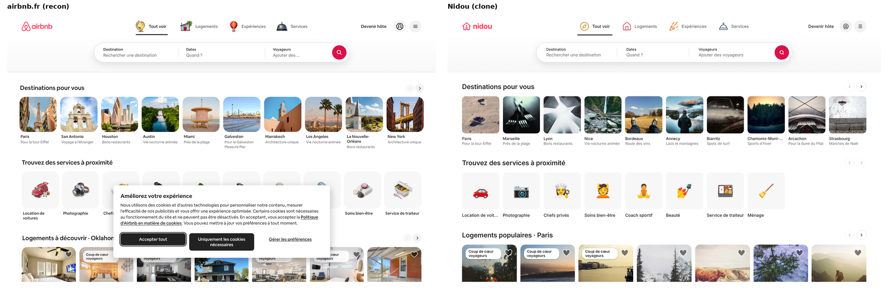
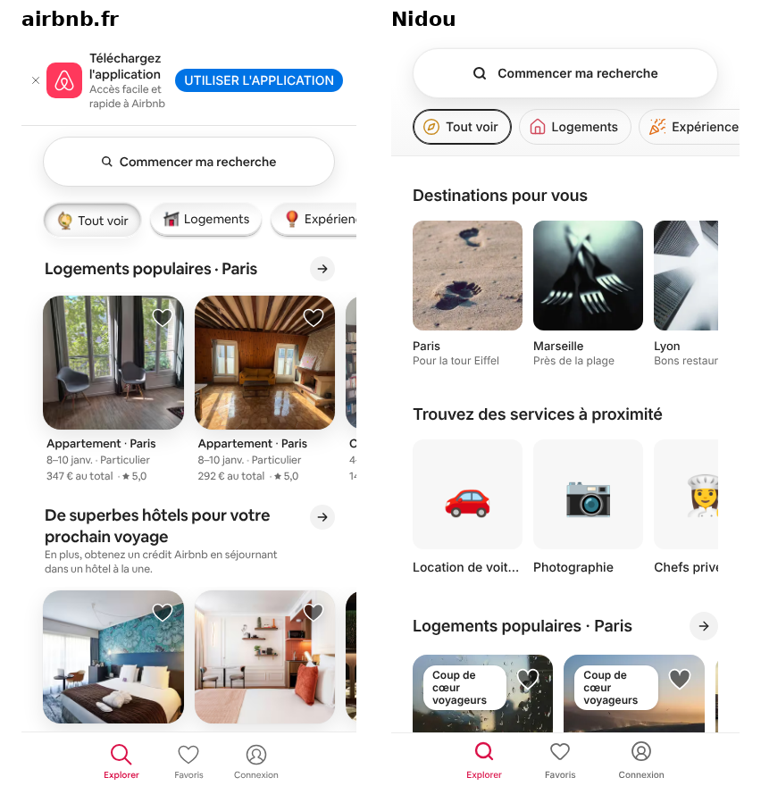

# QA report: Nidou (airbnb.fr replica)

Test pass run on 2026-10-13 against the production build (`next build && next start`) and a seeded Postgres 16 test database, on Chromium (desktop 1440×900 and Pixel 7). Every issue found has been fixed or is listed under **Known issues**, and each fix has a test that would fail if it came back.

## Result

| Suite | Command | Tests | Result |
|---|---|---|---|
| Unit (UTC, UTC+14, UTC−7/−8) | `pnpm test` | 60 | ✅ |
| Integration, Postgres | `pnpm test:integration` | 31 | ✅ |
| End-to-end + API contract | `pnpm test:e2e` | 65 run, 21 device-specific skips | ✅ twice in a row (`--repeat-each=2`: 130/130) |
| Lint, types, build | `pnpm lint && pnpm typecheck && pnpm build` | | ✅ |

Unit + integration coverage of `lib/` went from **61% to 85%** of statements (server code: 95%). The rest (client hooks, cache wrappers) runs in the e2e suites.

## What the tests cover

| Area | Where | Highlights |
|---|---|---|
| Formatting, URL params, pricing, guest rules, fixtures | `tests/unit` | French date ranges, junk URL params, price lines always summing to the total |
| Timezones | `tests/unit/*.tz.test.*` (run under 3 TZs), `tests/integration/timezones.test.ts`, `tests/e2e/timezone.spec.ts` | Clicked calendar days reach the URL unchanged; "today" is the listing's local date |
| Favourites store, search state | `tests/unit/wishlist-store.test.ts`, `search-draft.tz.test.tsx` | Sign-in merge, optimistic rollback, nothing left behind after sign-out |
| Catalogue, bookings, favourites, reviews | `tests/integration` | Availability filtering, pagination never repeats a card, **6 concurrent bookings → exactly 1 wins**, ownership checks |
| HTTP layer | `tests/integration/http.test.ts` | Error mapping hides internals, Origin check, invalid JSON, forged session cookie |
| API contract | `tests/e2e/contract.api.spec.ts` | Every route: status codes, error shape, auth, IDOR, input limits, cookie flags, security headers |
| Security in the browser | `tests/e2e/security.spec.ts` | Open-redirect payloads, markup injection through URL and search box |
| Accessibility | `tests/e2e/a11y.spec.ts` (axe, WCAG 2.1 A/AA) | Home, all search panels, mobile sheet, results, login, favourites, trips, account menu, cookie banner |
| Keyboard | `tests/e2e/keyboard.spec.ts` | Full search without a mouse, Escape, photo arrows on focus |
| Design conformance | `tests/e2e/design.spec.ts` | Header 96/80 px, search bar 850×66, #DA1249 button, 14/20 type, 48 px gutter, 7 cards / 10 tiles across, mobile card width: all from the recon |
| User journeys | `home`, `search`, `accounts` specs | Search → results, pinning, sign-up/in/out, favourites sync, book → trips → cancel |

## Findings

| # | Severity | Area | Finding | Fix | Guarded by |
|---|---|---|---|---|---|
| 1 | **High** | Security | **Open redirect**: `/login?next=/\evil.example` sent users to `evil.example` after signing in (`/\` and `/\t/` are protocol-relative to browsers; the check only blocked `//`). A real Nidou link could drop users on a phishing site. | `lib/safe-redirect.ts` resolves `next` with the URL parser and requires same origin | 10 payloads in `tests/unit/safe-redirect.test.ts`, 5 in a real browser in `security.spec.ts` |
| 2 | Medium | Security | No security headers; `X-Powered-By: Next.js` exposed | `next.config.ts`: `frame-ancestors 'none'` / `X-Frame-Options`, `nosniff`, referrer and permissions policies, HSTS; powered-by header off | `contract.api.spec.ts` |
| 3 | Medium | Security | The session cache cookie carried the user's name and email in readable base64 (signed, not encrypted) | Better Auth cookie cache switched to encrypted JWE | `contract.api.spec.ts` decodes the cookies and looks for the email |
| 4 | Medium | Bookings | "Today" was the UTC date: at 22:00 in New York a same-day stay was refused as "in the past" (and cancellations cut off a day early in some zones) | `Place.timezone` (migration `place_timezone`); check-in and cancellation rules use the listing's local date | `tests/integration/timezones.test.ts`, `dates.tz.test.ts` |
| 5 | Serious (WCAG 2.1.1) | Accessibility | Photo carousels on every card were scrollable regions keyboard users couldn't reach; the arrows were mouse-hover only | Arrows live inside the strip, are focusable at every size and show on focus | axe in `a11y.spec.ts`, `keyboard.spec.ts` |
| 6 | Serious (WCAG 4.1.2) | Accessibility | Destination suggestions nested buttons inside `role=option` | Plain list of buttons, plus ↑/↓ navigation from the input | axe, `keyboard.spec.ts` |
| 7 | Serious (WCAG 1.4.3) | Accessibility | Active mobile-nav label: brand pink on white at 10 px, 3.5:1 | Darker brand red #DA1249 (5.0:1) | axe |
| 8 | WCAG 2.4.3 | Accessibility | Picking a suggestion with the keyboard dropped focus to `<body>` | Focus moves to the newly opened segment | `keyboard.spec.ts` |
| 9 | Minor | Accessibility | Results page jumped from `h1` to card `h3`s (Lighthouse 98) | Hidden `h2` before the grid | Lighthouse 100 |
| 10 | Low | API | `page` above 500 silently returned page 1 | Pages up to 10 000; past the end is empty, junk is page 1 | `contract.api.spec.ts` |
| 11 | Low | Parity | Mobile cards 42% of content width vs 46% on airbnb.fr (2.7 vs ~2.2 visible) | 46% | `design.spec.ts` |
| 12 | Low | Parity | Destination/service tiles 7 across vs 10 on airbnb.fr | Denser tile track (10 / 8 / 6 / 36%) | `design.spec.ts` |
| 13 | Perf | Performance | LCP photo not fetched first (`priority` is deprecated in Next 16 and no longer sets `fetchpriority`); calendar JS shipped with every page; oversized `sizes` | `loading="eager"` + `fetchPriority="high"` for LCP candidates, calendar loaded on demand, tighter `sizes` | Lighthouse (below) |
| 14 | Low | Dev tooling | Prisma 7's `migrate dev` no longer regenerates the client, so code saw the old schema after a migration | `pnpm db:migrate` runs `prisma generate` too | n/a |
| 15 | Test suite | Tests | Booking e2e tests collided with themselves on repeat/retry (CI retries once); one test raced sign-out against navigation | Dates shifted per repeat/retry (`stayDays`); test waits for the signed-out UI | `--repeat-each=2` run |

### Checked and fine (no change needed)

- **Injection**: markup in the URL or search box is rendered as text; queries are parameterised (`%`, `_`, quotes and 5 000-character inputs are harmless).
- **Access control**: other users' bookings read as 404 (no id probing); writes need a session and a same-origin `Origin`; forged cookies are 401.
- **Sessions**: `HttpOnly`, `SameSite=Lax`, 30-day expiry; sign-in is rate-limited (429 after 3 attempts in 10 s).
- **Errors**: 500s carry a generic French message, never stack traces or connection details.
- **Double booking**: the Postgres exclusion constraint holds under concurrent requests and direct inserts.
- **Dates**: clicked days are stable in UTC+14 and UTC−8.

## Performance (Lighthouse 13, simulated mobile slow 4G / desktop)

| Page | Before | After |
|---|---|---|
| Home, mobile | Perf 76 · LCP 5.4 s · A11y 100 | **Perf 81–86 · LCP 3.6–3.7 s** · A11y 100 |
| Results, mobile | Perf 74 · LCP 5.7 s · A11y 98 | **Perf 78–88 · LCP 3.8–4.8 s · A11y 100** |
| Home, desktop | 100 · 100 · 100 · 100 | 100 · 100 · 100 · 100 (LCP 0.7 s) |

Best practices and SEO are 100 everywhere; CLS is 0. Two runs per page after the fixes; the ranges show run-to-run variance.

## Parity with airbnb.fr

| Feature (from the recon) | airbnb.fr | Nidou |
|---|---|---|
| Header: logo, 4 category tabs, host link, profile, menu | ✅ | ✅ static icons instead of animated 3D videos |
| Search bar, 3 segments + popovers | ✅ | ✅ |
| Compact search pill on scroll | ✅ | ✅ |
| Destination / services / listing carousels | ✅ | ✅ |
| Listing card: photo swipe, badge, heart, dates, price, rating | ✅ | ✅ |
| "Des idées" link grid with tabs, footer | ✅ | ✅ smaller link set |
| Cookie consent | ✅ | ✅ no preferences panel yet |
| Mobile: search pill, chips, bottom nav | ✅ | ✅ |
| Mobile: app-download banner | ✅ | — (no app) |
| Mobile: listings first, destinations later | ✅ | — Nidou leads with destinations and services |
| Language / currency picker | ✅ | — buttons only |
| Search map, filters panel | ✅ | — (P2) |
| Listing page with booking card | ✅ | — (P3; the booking API is ready) |

## Known issues (not fixed)

| Issue | Why it's open | Recommendation |
|---|---|---|
| Session cookies have no `Secure` flag in these runs | Local http; Better Auth sets it when `BETTER_AUTH_URL` is https | Deploy behind https only |
| No `script-src` in the CSP | Needs per-request nonces for Next.js inline scripts | Add a nonce-based CSP via `proxy.ts` |
| Mobile LCP ~3.7 s on slow 4G | Mostly the remote placeholder photos (picsum) going through the image optimizer on first request | Real photos on a CDN; re-measure |
| ~78 KiB unused JS | Framework baseline (React/Next runtime) | Revisit as pages grow |
| Back/forward cache blocked on dynamic pages | Next.js sends `Cache-Control: no-store` for dynamic responses | Framework behaviour |
| `/trips` splits upcoming/past by UTC date | Display only; the cancel rule itself uses the listing's date | Use each booking's place timezone when P3 lands |
| CI has not run on GitHub yet | The workflow triggers on pull requests and `main` | Open a PR |
