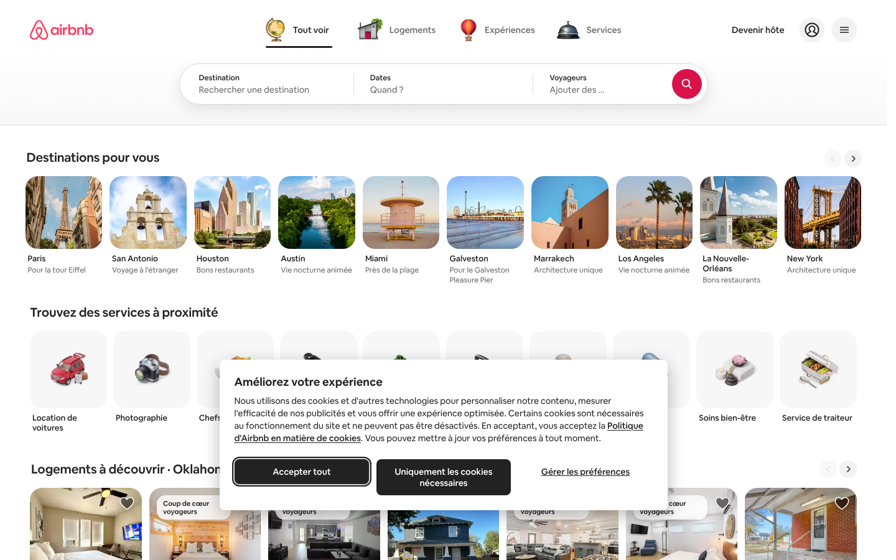
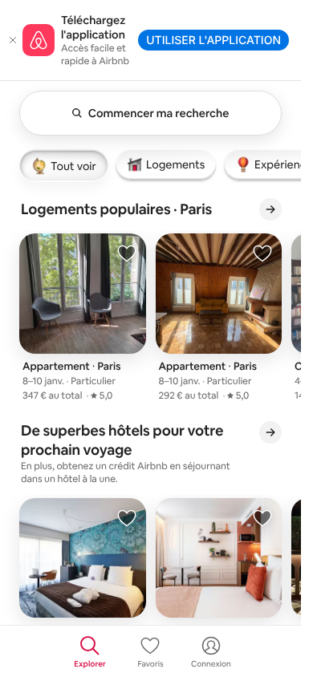

# Recon: airbnb.fr homepage

Captured 2026-10-12 with headless Chromium (Playwright) at **1440×900** (desktop) and **390×844** (iPhone UA), locale `fr-FR`, currency EUR.
Raw tokens: [`design-tokens.json`](./design-tokens.json) · Screenshots: [`screenshots/`](./screenshots)

| Desktop | Mobile |
|---|---|
|  |  |

> Note: with Playwright's default headless UA the desktop `<main>` renders **empty** (only the "ideas" link grid and the footer, see `desktop-home-empty-state.png`). With a normal Chrome UA the carousels load. A clone should still handle that empty/fallback state.

---

## 1. Page structure (top → bottom)

### Header (sticky, 96px tall + search bar ≈ 200px total, bg gradient white → `#F7F7F7`)
- **Left:** Airbnb logo (Rausch `#FF385C`), `48px` side padding.
- **Center tab list** (`role=tablist`): `Tout voir` · `Logements` · `Expériences` · `Services`. Each tab = 3D illustrated icon (globe, house, hot-air balloon, service bell; these are short **videos** `tab-bar-entry-video` that animate on hover/select) + label. Active tab: `#222` label, 2–3px black underline; inactive: `#6A6A6A`.
- **Right** (`nav[aria-label=Profil]`): "Devenir hôte" text link, round profile button (40px, `#F2F2F2` bg), round hamburger menu button.

### Search bar (`form[role=search]`, `data-testid=big-search`)
- Pill, ~850×66px, `border-radius: 32px`, white, shadow `elevation3` (`0 0 0 1px rgba(0,0,0,.02), 0 8px 24px rgba(0,0,0,.1)`).
- 3 segments separated by 1px `#DDDDDD` dividers:
  - **Destination**: label 12px/500 + placeholder "Rechercher une destination" (14px, `#6A6A6A`)
  - **Dates**: "Quand ?"
  - **Voyageurs**: "Ajouter des voyageurs"
- Search button: 48px circle, bg `#DA1249` (`--palette-bg-tertiary-core`), white magnifier icon.
- Segment click → popovers (autosuggest via `AutoSuggestionsQuery`, date-range calendar, guest counters). On scroll the bar collapses into the compact "little search" pill (`little-search-icon`).

### Main: horizontal carousel sections
Personalised by geo-IP; captured titles:
1. **Destinations pour vous**: square city tiles (~124px, radius 12px) + city name 13px/500 + subtitle 12px `#6A6A6A` ("Pour la tour Eiffel", "Vie nocturne animée").
2. **Trouvez des services à proximité**: square tiles on `#F7F7F7` with 3D object renders (car, camera, chef…) + label.
3. **Logements à découvrir · {ville}** / **Logements populaires · Paris** / **Logements disponibles ce week-end** / **De superbes hôtels…** / **Expériences populaires**.
- Section header: H2 22px/600 (`titles-semibold_22_26`) left; right side round 32px prev/next arrow buttons (disabled = `#DDDDDD` faded). Mobile: single "→" button, "Tout afficher" link.
- Scroller (`data-testid=content-scroller`): ~7 cards visible at 1440px, gap ≈ 12px, snap-scroll.

### Listing card (`data-testid=card-container`, `role=group`)
```
┌───────────────────────┐
│ [Coup de cœur      ]♡ │  ← optional white pill badge (top-left), heart save button top-right
│        photo          │     image: object-fit cover, radius ~16–20px, ~1:0.95 ratio
│     (●●○○○ dots)      │     (desktop ≈ 180×170, mobile ≈ 158×150)
└───────────────────────┘
Appartement · Paris          13px/500 #222   (data-testid=listing-card-title)
8–10 janv. · Particulier     12px/400 #6A6A6A
347 € au total · ★ 5,0       12px/400 #6A6A6A, separators #C1C1C1
```
- Whole card is an `<a target=_blank>` overlay → `/s/homes?pinned_listings[]=…` (search page with listing pinned), or `/rooms/{id}`.
- Images from `a0.muscache.com/im/pictures/...?im_w=240|320|480|720|960` with `<picture>` srcset per breakpoint.
- Heart: white outline over a translucent dark fill; filled Rausch when saved.

### "Des idées pour vos prochaines escapades" (SEO link grid)
- Tabs: Équipements recherchés · Sur la côte · Montagnes · Sports d'hiver · Activités (underline active).
- 6-column grid of `Ville` (14px/500) + `Locations de vacances` (14px, `#6A6A6A`), "Afficher plus ⌄".
- Section bg `#F7F7F7`.

### Footer (bg `#F7F7F7`, top border `#DDDDDD`)
- 3 columns (H3 14px/600): **Assistance** (Centre d'aide, Assistance sécurité, AirCover, Lutte contre la discrimination, Assistance handicap, Options d'annulation, J'ai un problème de voisinage) · **Accueil de voyageurs** (Mettez votre logement…, Proposez votre expérience…, Proposez votre service…, AirCover pour les hôtes, Ressources, Forum, Hébergement responsable, Cours gratuit, Trouver un co-hôte, Parrainer un hôte) · **Airbnb** (Édition été 2026, Newsroom, Carrières, Investisseurs, Cartes cadeaux, Séjours d'urgence Airbnb.org).
- Bottom bar: `© 2026 Airbnb, Inc. · Confidentialité · Conditions générales · Fonctionnement du site · Infos sur l'entreprise`; right: 🌐 Français (FR), € EUR, Facebook / X / Instagram icons.

### Overlays
- Cookie consent modal (centered, white, radius 16px): "Améliorez votre expérience", buttons **Accepter tout** / **Uniquement les cookies nécessaires** (black `#222` filled, radius 8px) + "Gérer les préférences" underlined link.

### Mobile (<744px)
- Top "Téléchargez l'application" smart banner.
- Header replaced by a single pill "🔍 Commencer ma recherche" (radius 32px, shadow).
- Category tabs become horizontally scrolling chips with icons.
- Card carousels: ~2.3 cards visible.
- **Bottom tab bar** (fixed): Explorer (active, Rausch) · Favoris · Connexion.

---

## 2. Design tokens (summary)

Full set in `design-tokens.json` (372 palette vars, 104 typography, spacing/radius/elevation/motion).

**Colors**
| Token | Value | Use |
|---|---|---|
| `rausch` | `#FF385C` | brand, logo, active nav (mobile) |
| `product-rausch` | `#E00B41` | |
| `bg-tertiary-core` | `#DA1249` | search button |
| rausch gradient | `linear-gradient(to right,#E61E4D,#E31C5F,#D70466)` | primary CTAs (Réserver) |
| `hof` | `#222222` | primary text, dark buttons |
| `foggy` | `#6A6A6A` (renders `#6C6C6C`) | secondary text |
| `bobo` | `#B0B0B0` | disabled |
| `deco` | `#DDDDDD` | borders, dividers |
| `bebe` | `#EBEBEB` | |
| `faint` | `#F7F7F7` | section/footer bg, hover |
| `arches` | `#C13515` | error |
| `spruce` | `#008A05` | success |
| `bg-link` | `#0D4DAA` | links |

**Typography**: `"Airbnb Cereal VF", Circular, -apple-system, BlinkMacSystemFont, Roboto, "Helvetica Neue", sans-serif`. Base 14px / 20px line-height. Weights 400/500/600 (700 rare). Scale: 12 · 13 · 14 · 16 · 18 · 22 · 26 · 32; display 40–72 (600).
*Cereal is proprietary: use a free substitute in the clone (e.g. **Inter**, **Plus Jakarta Sans** or **Nunito Sans**).*

**Spacing**: micro 2/4/8/12/16/24/32 · macro 16/24/32/40/48/64/80. Page gutter 48px desktop (24px tablet, 24px mobile).

**Radius**: 4 · 8 · 12 · 16 · 20 · 24 · 28 · 32 · 50% (circles) · pills.

**Elevation**
- `elevation1`: `0 0 0 1px rgba(0,0,0,.02), 0 2px 4px rgba(0,0,0,.16)`
- `elevation3` (search bar): `0 0 0 1px rgba(0,0,0,.02), 0 8px 24px rgba(0,0,0,.1)`
- `secondary` (popovers): `0 6px 16px rgba(0,0,0,.12)`
- `high` (modals): `0 8px 28px rgba(0,0,0,.28)`

**Motion**: standard `cubic-bezier(0.2,0,0,1)`, enter `cubic-bezier(0.1,0.9,0.2,1)`, exit `cubic-bezier(0.4,0,1,1)`; spring durations ~450–760ms (CSS `linear()` easings in the JSON).

**Breakpoints** (from image `<source media>`): `≤743px` mobile · `744–1127` · `1128–1439` · `≥1440px`.

---

## 3. Tech observations
- Custom SSR React app ("Hyperloop" + "airmetro" bundler), **not** Next.js. Atomic CSS-in-JS (Linaria, `atm_*` class names). State inlined in `<script id="data-deferred-state-0">` (~130 KB).
- Data via **persisted GraphQL** queries: `GET /api/v3/{OperationName}/{sha256}?operationName=…&variables=…`. Seen: `Header`, `AutoSuggestionsQuery`, `NaviServerAnnouncements`, `PromotionsByPlacementsQuery`, `GetConsentForUserQuery`; REST `/api/v2/client_configs`, `/api/v2/user_markets`, `/api/v2/get-data-layer-variables`.
- ~209 requests on load (112 JS, 24 images, 12 media/video for the tab icons). CDN: `a0.muscache.com`.
- Test hooks worth mirroring in the clone for e2e tests: `big-search`, `structured-search-input-field-query`, `structured-search-input-search-button`, `card-container`, `listing-image`, `listing-card-title`, `listing-card-save-button`, `content-scroller`, `cypress-headernav-profile`.

---

## 4. Suggested clone scope & stack

**Pages (MVP → later)**
1. `/`: header + tabs, big search, carousels, SEO grid, footer, mobile bottom nav. ✅ fully mapped above
2. `/s/{place}/homes`: results grid + filters + sticky map (Leaflet/Mapbox). *Not yet reconned.*
3. `/rooms/{id}`: photo mosaic, details, amenities, reviews, sticky booking card with date picker. *Not yet reconned.*
4. Auth modal, wishlists (Favoris), host flow: later.

**Stack suggestion:** Next.js (App Router) + TypeScript + Tailwind (map tokens above into `tailwind.config`) + Radix/shadcn for popovers/dialogs + `react-day-picker` for the date range + Embla Carousel for scrollers + a mock JSON/SQLite data layer (Prisma) seeded with fake listings.

**Legal/IP:** don't ship Airbnb's logo, Cereal font, 3D tab illustrations, or listing photos from `muscache.com`. Use your own brand name/logo, a free font, and placeholder imagery (Unsplash or generated).

**Next recon steps:** search results page, listing detail page, and the open states of the search popovers (destination autosuggest, calendar, guests).
