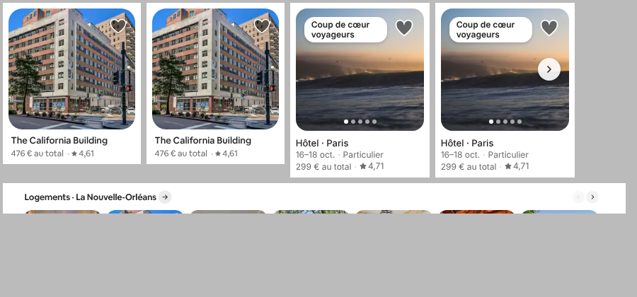
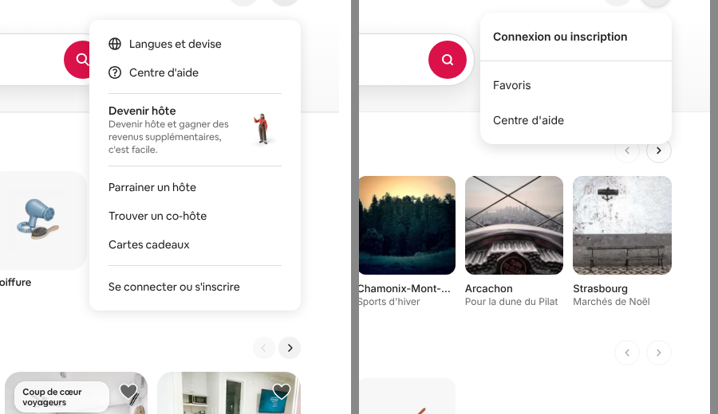
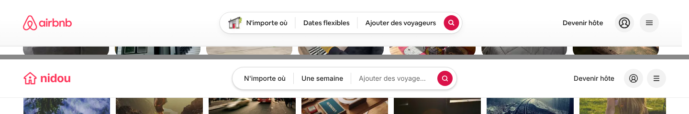

# Replica diff: airbnb.fr vs Nidou

How close the Nidou replica got to airbnb.fr, measured surface by surface on 13–14 October 2026, and what to fix first if parity is the goal. The full list of the 173 verified differences, with every measurement, is in [replica-diff-appendix.md](./replica-diff-appendix.md).

> **Which Nidou this is.** The comparison is against the replica as of commit `efca1b1`, the last commit before the ski-resort pivot (`cb64d29`). The pivot deliberately removed some of what is compared here (Expériences, Services, city destinations) and added some of what was missing (a listing page with a booking card). [What the pivot already changed](#what-the-pivot-already-changed) maps the two.

## Summary

The shell is close; the gaps are whole surfaces and interaction models, not pixels.

- **What matches** (measured on both sites): the 850×66 search bar with its 48 px #DA1249 button, the 3 px #222 active-tab underline, 7 listing cards per desktop row with 12 px gaps, the compact pill that expands in place over a 25 % scrim and focuses the destination, the category-tab URLs (`/homes`, `/experiences`, `/services`), the "Des idées" grid (5 tabs, 6 columns, 17 links collapsed) and the footer's 3 columns on #F7F7F7.
- **What is missing** (12 high-severity differences, 5 distinct gaps): the listing page and checkout, the results map, search filters, and the content of the Expériences and Services verticals.
- **What behaves differently**: sign-in is a separate page instead of an in-page modal, the heart saves locally instead of asking you to sign in, "Devenir hôte" goes to the login page instead of a host-type chooser, the language and currency buttons do nothing, and the search bar has no flexible dates, date tolerance or price hints.
- **What drifts**: about 70 low-severity visual and copy details (radii of 16 px instead of 20 px, outlined instead of filled steppers, title weights, card photo ratios, footer link sets).

| | Claimed | Kept | High | Medium | Low |
|---|---|---|---|---|---|
| Desktop homepage | 38 | 38 | 1 | 21 | 16 |
| Desktop search and results | 41 | 41 | 3 | 23 | 15 |
| Mobile | 54 | 54 | 3 | 22 | 29 |
| Beyond the homepage | 41 | 40 | 5 | 24 | 11 |
| **Total** | **174** | **173** | **12** | **90** | **71** |

Of the 173 kept, 160 were reproduced exactly and 13 were real but re-measured with different values (the appendix shows the corrected ones). Many gaps were reported by several groups (the map by desktop, mobile and the API check, for example); merged, they come to **134 distinct differences**.

## How it was measured

1. **Four surface groups**, each with its own agent driving both sites with Playwright in the same state: desktop homepage, desktop search and results (1440×900), mobile (390×844, iPhone user agent), and the pages beyond the homepage (listing page, checkout, Expériences, Services, sign-in, favourites, trips, 404, routes and API). Each difference carries the measurements behind it: bounding boxes, computed styles, visible copy and URLs.
2. **One adversarial verifier per group** re-measured every claim on both live sites and confirmed, corrected or refuted it.
3. **A completeness critic** looked for states nobody compared and for duplicates.
4. **A blind spot-check**: a separate auditor re-measured a sample of 13 claims without seeing any verdict (see [How much to trust this](#how-much-to-trust-this)).

Rules: airbnb.fr was only browsed logged out, with no account created and nothing booked or paid; differences caused only by the brand, photos, live prices or personalisation were not counted.

## Fix first

Ordered by user impact. IDs point to the appendix; where a row lists several IDs they are the same gap seen from different places.

### 1. Missing surfaces (high)

| # | Gap | airbnb.fr | Nidou `efca1b1` | IDs |
|---|---|---|---|---|
| 1 | **Listing page and checkout** | Cards open `/rooms/<id>` in a new tab: photo mosaic and photo tour, highlights, description, amenities, availability calendar, reviews with category scores, map, host card, "À savoir", a sticky booking card, then `/book/stays/<id>` ("Confirmer et payer") | Cards open the results page with the listing pinned; `/rooms/<id>` and `/book/stays/<id>` are 404. The booking API exists but nothing in the UI books | beyond-01, 03–15, 04, 05, 02, home-13, search-09, mobile-44 |
| 2 | **Results map** | Sticky Google map (650×684, radius 20 px) with white price pills that turn dark when you hover a card; on mobile the map fills the top and the list is a bottom sheet with a "Carte" button; dragging re-searches by bounds | No map, and the listings API ignores bounds | search-01, 02, mobile-35, beyond-39 |
| 3 | **Filters** | "Filtres" button and modal (type, price range, rooms and beds, amenities…), quick-filter chips on mobile | None, on desktop or mobile | search-03, mobile-36, 37, beyond-39 |
| 4 | **Expériences and Services content** | Experience cards open experience pages; `/services` has 9 categories of offers (72 cards) and service pages; the search bar adapts per vertical ("Ville, musée ou monument", "Type de service") | Experience cards open a homes search; `/services` is 8 emoji tiles that link back to `/services`; no experience or service detail pages; the homes search bar everywhere | home-01, 07, 15, beyond-16–22, 40, mobile-15 |

### 2. Main flows that behave differently (medium)

| # | Gap | airbnb.fr | Nidou `efca1b1` | IDs |
|---|---|---|---|---|
| 5 | **Sign-in** | In-page modal, one "phone or email" field first, Google and Apple buttons | Separate `/login` page with email and password, no social sign-in | home-03, beyond-23–26, mobile-46 |
| 6 | **Saving while signed out** | The heart and "Enregistrer" open the sign-in modal; `/wishlists` is a sign-in gate | The heart saves on the device at once; `/wishlists` lists device favourites | home-05, beyond-28, 29, mobile-45 |
| 7 | **"Devenir hôte" and the menu** | Opens "Que souhaitez-vous proposer ?" (Logement / Expérience / Service); the signed-out menu (265×365) has Langues et devise, Centre d'aide, a "Devenir hôte" promo, Parrainer un hôte, Trouver un co-hôte, Cartes cadeaux and "Se connecter ou s'inscrire" | Links to `/login`; the menu (240×165) has Connexion ou inscription, Favoris and Centre d'aide | home-02, 04, beyond-31, 33, 34 |
| 8 | **Search bar: dates** | "Dates" / "Flexible" tabs, ± day tolerance, cheaper days marked in green | Exact dates only, no tabs, no tolerance, no price hints | search-28, 29, 30, mobile-29 |
| 9 | **Search bar: destination** | Combobox with arrow-key highlight that keeps focus in the input, typed suggestions (cities, neighbourhoods, "À proximité"), the picked label written back ("Lyon, France"), a clear button | Arrow keys move focus into the list, one suggestion per city, the input keeps what you typed, no clear button | search-17, 18, 20–25, home-36, mobile-25, 26 |
| 10 | **Results page** | List and map side by side (2 cards per row), 4:3 photos, "243 € au total" opening a price breakdown, 18 per page with cursor paging, "Disponibles à des dates similaires" | Full-width 4-column grid, near-square photos, "250 € pour 2 nuits" as plain text, 24 per page numbered, no similar-dates section | search-04–11, mobile-38–42 |
| 11 | **URLs and titles** | `/s/Lyon--France/homes?place_id=…&refinement_paths[]=…`, descriptive page titles per destination | `/s/lyon/homes?checkin=…`, "Résultats de recherche · Nidou" everywhere | search-13, 14, mobile-43, beyond-38 |
| 12 | **Footer and pickers** | Every link goes to a real page; "Français (FR)" and "€ EUR" open language and currency dialogs; social links | Every footer link is `#aide`; the two buttons do nothing; no social links | home-17, 18, 27, 28, beyond-35, mobile-47–51 |
| 13 | **Cookie consent** | Banner over a 25 % scrim, focus moved to "Accepter tout", "Gérer les préférences" opens a preferences dialog | Non-modal banner, focus stays on the page, "Gérer les préférences" jumps to `#aide` | home-19–22, mobile-52, 53 |
| 14 | **Homepage rows** | Rows end with a "Tout afficher" tile, 28 px grey arrows, titles 20 px linking to the row's own filters, one photo per home card, rows that load as you scroll | No end tile, 32 px outlined arrows, 22 px titles linking to a bare search, a 5-photo strip with dots, all rows rendered at once | home-08–12, mobile-13, 14, 17 |
| 15 | **Mobile search sheet** | Logements / Expériences / Services tabs, a capped suggestion list, a continuous vertical calendar, "Suivant" / "Réinitialiser" per step | A static "Logements" title, every suggestion listed (702 px tall), one month at a time, always "Tout effacer" / "Rechercher" | mobile-22–34 |

### 3. Polish (low)

Typography weights and line heights, radii (16 px where airbnb.fr uses 20 px), filled vs outlined steppers, badge and heart sizes, the 404 page layout, account-page headers, the app-download banner and the animated 3D tab icons. All are in the appendix with values on both sides.

## Defects in the replica

These are bugs rather than parity choices: worth fixing even without copying airbnb.fr. "On `main`" says whether the current, pivoted code still has them.

| Defect | IDs | On `main` (`cb64d29`) |
|---|---|---|
| Picking only a check-in day labels the dates segment "24–24 nov." instead of "24 nov." (the calendar reports the first click as a one-day range, which `datesLabel` doesn't treat as a single day) | search-34 | Code unchanged |
| Footer links all point to `#aide` | home-18, mobile-47 | Fixed: the new footer only links to real pages |
| "Gérer les préférences" in the cookie banner and an item of the user menu point to `#aide` | home-19 | Still there |
| "Français (FR)" and "€ EUR" are buttons that do nothing, with no accessible description | home-17, beyond-35, mobile-50 | Still there |
| The destination input has no combobox semantics (no role, `aria-expanded`, `aria-controls` or `aria-activedescendant`) | search-21 | Still there |
| The cookie banner is a dialog that does not take focus | home-22 | Still there |
| The "+" for adults and children stays enabled at the 16-guest cap and silently ignores clicks | search-39 | Fixed: disabled when the party is full |
| The logo link stretches to 383 px, so empty header space is clickable | home-32 | Not re-checked |
| After a client-side tab switch the previous page stays mounted but hidden (two `<main>` elements) | home-38 | Next.js 16 behaviour; the e2e tests now count visible elements only |

## Differences not worth copying

Our judgement, not part of the measured verdicts: in these cases Nidou's version is as good or better, and parity would be a regression.

- **Heart and photo buttons at 44×44** (airbnb.fr: 32×32): larger touch targets (mobile-12, search-41).
- **Card titles as `h3`** (airbnb.fr: no headings in cards): lets screen-reader users jump between listings (mobile-18).
- **Enter in the destination field submits the search** (airbnb.fr: Enter does nothing until a suggestion is picked) (search-23).
- **Saving favourites without an account**, merged into the account on sign-in: fewer steps for a new visitor (home-05, mobile-45). Keep it unless sign-up conversion is the goal.

## What the pivot already changed

The ski-resort pivot (`cb64d29`, see the [README](../README.md)) is a different product, so several gaps above no longer apply to `main`.

| Gap | Status on `main` |
|---|---|
| 1. Listing page | `/rooms/<id>` exists: photo mosaic, facts, classification and registration number, amenities, reviews, host, and a booking card with an availability-aware calendar, live quote and booking. Still missing compared with airbnb.fr: the photo tour, the map, "À savoir", similar listings, share, and checkout with payment |
| 4. Expériences and Services | Removed on purpose; the routes redirect to `/` |
| 12. Footer links | Real links only (owners page, resorts) |
| Card click | Opens the listing page in the same tab |
| Destinations | Two resorts instead of 18 cities, so search suggestions, rows and the ideas grid changed too |

Everything else (map, filters, sign-in modal, search-bar features, results layout, cookie preferences, pickers) still applies as measured.

## How much to trust this

- **Verification was one-sided.** Only 1 of 174 claims was refuted, and none in three of the four groups. The critic read this as a verification pass that may have checked that differences exist without challenging their details. The blind spot-check below measures that.
- **Personalisation.** airbnb.fr personalised rows by IP and the proxy resolved to the United States (rows such as "San Antonio" and "Dallas"). Row order, cities and which listings appear were therefore not counted. home-06 (a hotels row on the homepage) was reproduced again in the spot-check, but whether airbnb.fr shows that row depends on the visitor.
- **A/B variants.** The date-tolerance controls appeared in two variants across sessions (search-29, 32).
- **Headless rendering.** airbnb.fr sometimes reserved a 15 px scrollbar in headless Chromium; widths were corrected for it.

### Blind spot-check

A separate auditor re-measured 13 claims on both live sites without seeing any verdict, using 11 airbnb.fr page loads: 12 measurable medium-severity claims spread over the homepage, search and mobile groups (home-09, 10, 16, 18, search-04, 06, 10, 22, 26, 34, mobile-07, 28) plus home-06, the one the critic doubted.

**All 13 held** within the tolerance set beforehand (2 px or 5 %). The only drift: airbnb.fr widths up to 1.4 % larger than recorded, because this run had no headless scrollbar, and one miscount (the footer has 20 links plus 2 buttons, not 22 links). So for measurable claims, the low refutation rate reflects accurate finders rather than a lenient verifier. Behaviour behind sign-in or after submitting a form could not be checked by either pass.

## Not compared

From the critic, ranked by importance. These are the next things to measure if the comparison is extended.

| Importance | What | Why it matters |
|---|---|---|
| High | Signed-in airbnb.fr: wishlists with named lists, trips with detail and cancellation, the signed-in menu | Nidou's most complex features (accounts, favourites sync, bookings, cancellation) have no reference |
| High | Widths between the two tested ones: 1128–1439 px (most laptops) and 744–1127 px (tablets) | Only 1440 and 390 were measured |
| High | Mobile versions of the listing page, Expériences, Services, favourites, trips, sign-in and 404 | The mobile group only covered home, search and results |
| Medium | Expériences and Services search flows and their results pages | Only the homes search was exercised |
| Medium | Results reached from a pinned card, loading and skeleton states, keyboard focus and dismissal, return-visit states ("Recherches récentes"), map interactions, checkout after step 1 | Each is a common state nobody captured |
| Low | Header and search-bar hover states, auth form validation, mobile range selection and end of results, tile click targets, error handling for bad deep links, other ideas-grid tabs, home and listing titles, cookie-consent persistence | Smaller surfaces |

## Evidence

The scripts, screenshots and JSON dumps behind every number (about 240 MB) stayed in the session's scratch space and are not in the repository. Three side-by-side crops are kept here:

| Listing card at rest and on hover | Menu, signed out | Header after scrolling |
|---|---|---|
|  |  |  |
